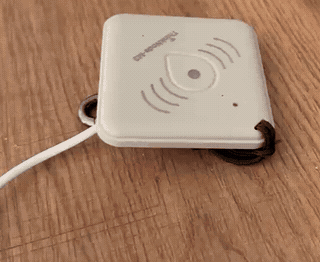
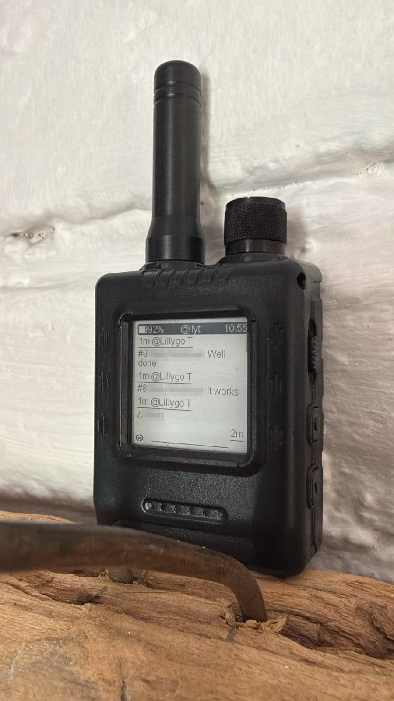
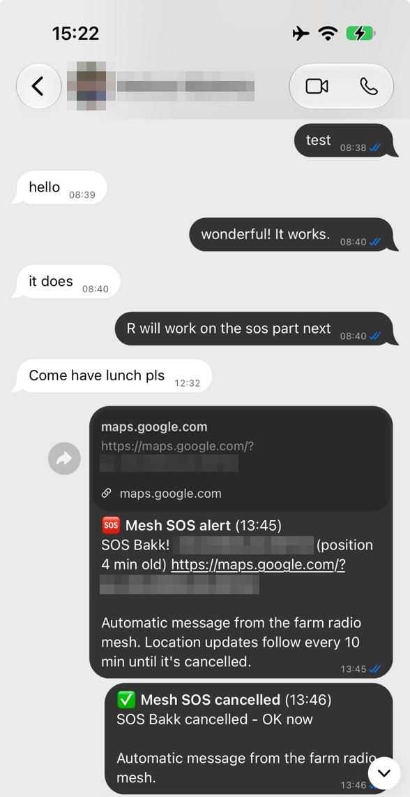

## veld-mesh: radio tools for farms and places with no signal

On a farm the house usually has internet, but out in the lands, the kloofs and the veld
there's often no cell signal at all. Two-way radios help, but they're not always
monitored, a missed call is gone, and "I'm near the old dam" isn't a position. Meanwhile
**WhatsApp is how everyone here actually talks.**

We build on [Meshtastic](https://meshtastic.org), a cheap LoRa mesh that relays messages
radio to radio until they arrive and knows where every radio is. On top of it we build:

### 🆘 [thinknode-sos](https://github.com/veld-mesh/thinknode-sos): a panic button anyone can use
Firmware that turns an Elecrow ThinkNode M3 into a hold-to-confirm SOS button for farm
workers, family and guests. **Hold it for 3 seconds:** it beeps loudly to confirm, then
everyone on the mesh gets an alert with a pin on the map. The alert repeats until it's
cancelled, and other SOS radios sound an alarm. No app or know-how needed.

### 💬 [veld-bridge](https://github.com/veld-mesh/veld-bridge): WhatsApp over the mesh
A box at the house (a NAS or Raspberry Pi) links to your WhatsApp. **Read and answer your
WhatsApps from a pocket radio in the field**, and have **SOS alerts land in the WhatsApps
and groups you choose**, with a map link and location updates. It's handy every day too:
farm watch, coordinating work, or getting everyone together for a braai after work.

<p>
  
  &nbsp;
  
  &nbsp;
  
</p>

```
hold 3 s ─► SOS radio ~~LoRa mesh~~ gateway at the house ─► veld-bridge ─► WhatsApp 📱
```

**Coming next:** Signal and Telegram alongside WhatsApp.

> ⚠️ These are community projects, not certified emergency equipment. They're not
> affiliated with Meshtastic, WhatsApp or Meta. Test them where you'll use them, and
> keep other ways to call for help.

Made in South Africa 🇿🇦 · GPL-3.0
